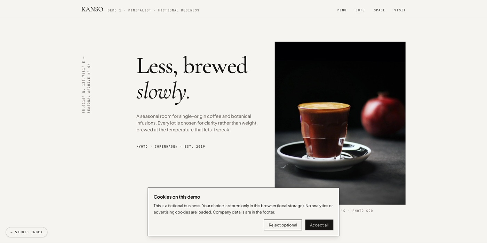
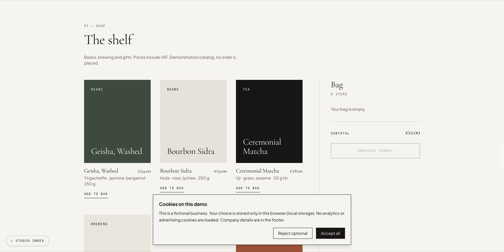
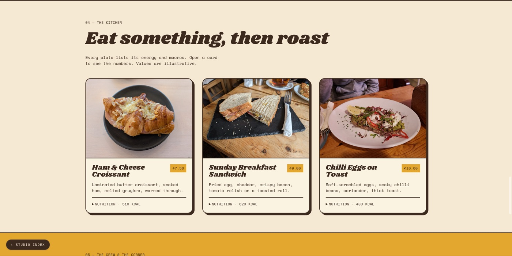
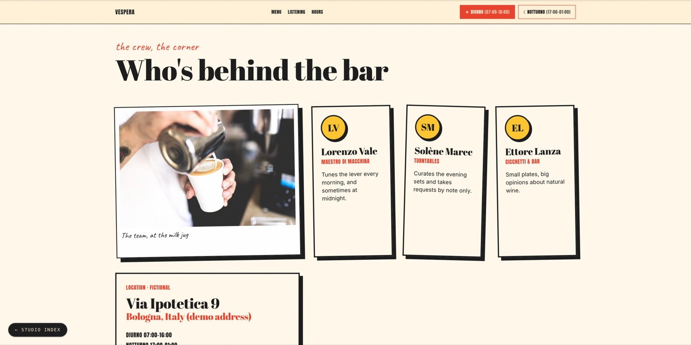

# Coffee Demos Studio

An agency-style showcase: a studio index (`/`) and three independent, fully fictional specialty coffee websites.

| Route | Concept | Direction |
|-------|---------|-----------|
| `/demo-1` | KANSO | Minimalist, Kinfolk-style editorial |
| `/demo-2` | SUNDAY ROAST '74 | Seventies diner roastery, retro |
| `/demo-3` | VESPERA | Loud, layered, day and night palettes |

Every business, address, product, price, team member and nutrition value is fictional. Legal identifiers are placeholders and are not valid registrations.

## Screenshots

| | |
|---|---|
|  |  |
|  |  |

## Features

- Interactive pieces: flavour filter, lot dossier drawer, brew calculator, roast telemetry chart, dispatch form, day/night switcher, reservation drawer, product cart.
- Per-menu-item nutrition panels (native `<details>`), fictional team and location blocks, legal footer.
- Cookie notice that stores only the visitor's choice in `localStorage`.
- View Transitions and Speculation Rules for near-instant navigation between routes.
- Strict TypeScript, security headers in `next.config.ts`, and an automated verification script.

## Stack

Next.js 15 (App Router), React 19, TypeScript (strict), Tailwind CSS v4, `next/font/google`. No animation or chart libraries.

## Run

```bash
npm install
npm run dev        # development server on http://localhost:3000
```

Production check:

```bash
npm run typecheck
npm run lint
npm run build
npm run start      # then open http://localhost:3000
node scripts/verify-all.mjs
```

## Photos

All photographs are CC0 1.0 from Wikimedia Commons, self-hosted in `public/photos/`. Sources are listed in [`public/photos/CREDITS.md`](public/photos/CREDITS.md). No photograph shows an identifiable person.

## License

[MIT](LICENSE). The photographs are CC0 and keep their own terms.
